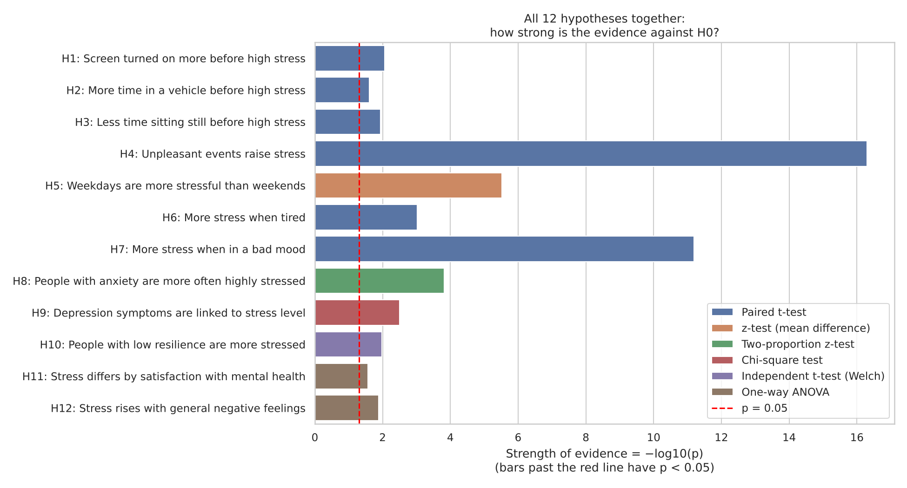

# What Causes Stress? (MobileWell100+)

Data Analytics project: data preprocessing, exploratory data analysis and 12 hypothesis tests
on everyday stress, using smartphone data and surveys from 103 participants in Spain.

**Tests used:** paired t-test, independent t-test, z-test, two-proportion z-test, chi-square test and one-way ANOVA.

## How to run

1. Download this repository (**Code → Download ZIP**) and unzip it.
2. Open a terminal in the unzipped folder.
3. Run:

```
python run_analysis.py
```

That is all. The script installs any missing Python library by itself (pandas, numpy, scipy,
matplotlib, seaborn), runs in about 10 seconds, prints the results and saves every chart and table
in the `results` folder. Requires Python 3.10 or newer. On Mac/Linux use `python3` if `python` is not found.

## Results

Stress = tense arousal from the daily survey (0 = very calm, 100 = very restless).

| | Hypothesis | Test | Result |
|---|---|---|---|
| H1 | Screen turned on more before high stress | Paired t-test | t(92) = 2.68, p = 0.009 |
| H2 | More time in a vehicle before high stress | Paired t-test | t(85) = 2.29, p = 0.025 |
| H3 | Less time sitting still before high stress | Paired t-test | t(85) = −2.58, p = 0.012 |
| H4 | Unpleasant events raise stress | Paired t-test | t(74) = 10.88, p < 0.001 |
| H5 | Weekdays are more stressful than weekends | z-test | z = 4.67, p < 0.001 |
| H6 | More stress when tired | Paired t-test | t(92) = 3.42, p < 0.001 |
| H7 | More stress when in a bad mood | Paired t-test | t(89) = 7.92, p < 0.001 |
| H8 | People with anxiety are more often highly stressed | Two-proportion z-test | z = 3.79, p < 0.001 |
| H9 | Depression symptoms are linked to stress level | Chi-square test | χ²(2) = 11.53, p = 0.003 |
| H10 | People with low resilience are more stressed | Independent t-test | t(38.1) = 2.69, p = 0.011 |
| H11 | Stress differs by satisfaction with mental health | One-way ANOVA | F(2, 100) = 3.76, p = 0.027 |
| H12 | Stress rises with general negative feelings | One-way ANOVA | F(2, 100) = 4.51, p = 0.013 |

All 12 null hypotheses are rejected at α = 0.05.



## Folder contents

```
├── run_analysis.py              the whole analysis: preprocessing → EDA → 12 hypothesis tests
├── requirements.txt             Python libraries used
├── data/                        input data (MobileWell100+)
│   ├── daily_survey.csv         stress reports, 6 per day
│   ├── initial_survey.csv       questionnaires (GAD-7, PHQ-9, resilience, PANAS)
│   ├── screen.csv               screen on/off events
│   └── activity_hourly.csv      % of each hour spent in a vehicle / sitting still
├── data_preparation/
│   └── make_activity_hourly.py  how activity_hourly.csv was made from the original 386 MB file
├── results/                     made by run_analysis.py (charts and tables)
└── report/
    ├── DA_Project_Report_Stress.docx   the project report
    └── hypothesis_documents/           H0/H1 list and a worked calculation for each hypothesis
```

The original `activity_recognition.csv` (386 MB) is too large for GitHub, so it was summarised per
participant per hour with `data_preparation/make_activity_hourly.py`. Everything else is the original data.

## Dataset

Banos, O., et al. (2022). *MobileWell100+: A multivariate longitudinal mobile dataset for investigating
individual and collective well-being* (Version 2) [Dataset]. Zenodo. https://doi.org/10.5281/zenodo.10975463
